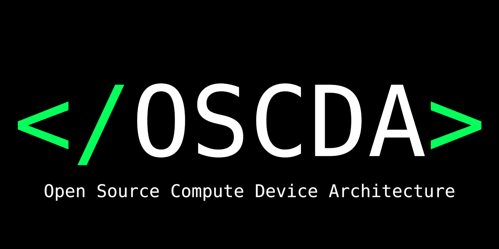

# OSCDA



OSCDA (Open Source Compute Device Architecture) is an experimental CUDA
compatibility runtime for **Intel GPUs on Linux**. Starting with version 0.3.0,
Intel is the project's sole hardware focus. [ZLUDA](https://github.com/vosen/ZLUDA)
already provides a strong AMD path; OSCDA instead targets Intel integrated and discrete GPUs, where Linux AI
users still face memory pressure, driver instability, and limited CUDA-oriented
tooling.

> [!WARNING]
> OSCDA is extremely experimental. It is developed independently in the
> maintainer's free time, without any compatibility, stability, performance, or
> support guarantee. Do not use it for production or safety-critical workloads.

The project is independent of Intel, NVIDIA, AMD, and ZLUDA. CUDA is an NVIDIA
trademark.

## Status

Version **0.3.0** begins the Intel migration with a native Linux Level Zero
backend. It currently provides:

- Intel GPU discovery through the standard `libze_loader` interface;
- CUDA-compatible device queries, allocation, free, copy, and memset;
- shared allocations on integrated GPUs to avoid an unnecessary host/device
  duplicate, and device-local allocations on discrete GPUs;
- a conservative per-process memory budget that rejects allocations before the
  driver reaches severe memory pressure;
- finite command timeouts, so a stalled GPU reports an error instead of making
  the process wait forever;
- runtime memory telemetry and a safe API for lowering or raising the budget;
- a deterministic CPU backend and a mock Level Zero driver for regression tests.

CUDA kernel execution is **not implemented yet** on the Intel backend.
`cudaLaunchKernel`, module loading, CUDA libraries, PyTorch CUDA wheels, and AI
framework compatibility remain future work. The next compiler milestone is a
PTX-to-SPIR-V path and Level Zero module/kernel execution. The former AMDGPU/HIP
translator and backend were removed rather than presented as Intel-compatible.

## Why Level Zero

OSCDA follows the architecture proven by ZLUDA's former Intel backend: use
Intel's low-level Level Zero API for contexts, memory, command lists, and later
SPIR-V modules. The implementation was independently adapted to OSCDA's small C
runtime and adds explicit memory budgeting and bounded waits.

Driver research is limited to public, legal interfaces: the open-source
[Intel Compute Runtime](https://github.com/intel/compute-runtime), the published
[Level Zero specification](https://oneapi-src.github.io/level-zero-spec/), and
the Linux [`i915` and `xe` DRM UAPI](https://www.kernel.org/doc/html/latest/gpu/driver-uapi.html).
OSCDA does not include proprietary Intel code and does not
bypass firmware signatures, kernel security, or device protections.

## Requirements

- Linux and CMake 3.20 or newer;
- a C11 compiler and pthreads;
- the Level Zero loader (`libze_loader.so.1`);
- Intel Compute Runtime with access to an Intel `/dev/dri/renderD*` node.

The Intel Compute Runtime supports both integrated Intel graphics and discrete
Arc GPUs. OSCDA loads Level Zero dynamically, so the project still builds and
its CPU tests run on machines without Intel hardware.

## Build and test

```sh
cmake -S . -B build -DCMAKE_BUILD_TYPE=Release
cmake --build build
ctest --test-dir build --output-on-failure
```

The `intel_runtime` test uses a mock loader and validates selection, memory
accounting, copies, fills, and configuration without requiring an Intel GPU.
Real-hardware validation is still required before reporting a device as tested.

Use `#include <osc/osc.h>` for OSCDA extensions or
`#include <cuda_runtime.h>` for the CUDA compatibility subset. Link with
`-losc`.

## Memory and hang controls

OSCDA reserves memory by default instead of exposing the entire physical pool:

- integrated GPU: reserves at least 512 MiB and caps the budget at half of the
  currently available host RAM;
- discrete GPU: reserves at least 256 MiB and otherwise keeps 10% of VRAM free.

The policy is intentionally conservative because an iGPU competes with the CPU
for system memory, while a dGPU can become unstable under VRAM exhaustion.

Environment variables:

| Variable | Purpose |
| --- | --- |
| `OSC_BACKEND=cpu` | Force the deterministic CPU backend. |
| `OSC_INTEL_DEVICE=N` | Select the Nth Intel GPU reported by Level Zero. |
| `OSC_INTEL_MEMORY_BUDGET_MB=N` | Override the initial OSCDA allocation budget. It cannot exceed reported physical memory. |
| `OSC_INTEL_TIMEOUT_MS=N` | Set the command completion timeout; default is 30000 ms. |
| `OSC_LEVEL_ZERO_LIBRARY=/path/libze_loader.so.1` | Test a specific Level Zero loader. |

Applications can inspect and adjust the live policy:

```c
oscIntelMemoryInfo_t info;
if (oscIntelGetMemoryInfo(&info) == cudaSuccess) {
    /* A new budget may not be below allocatedBytes or above physicalBytes. */
    oscIntelSetMemoryBudget(info.budgetBytes);
}
```

If a Level Zero command times out or the device is lost, OSCDA marks that
backend instance as stalled and rejects subsequent work. Automatic GPU reset is
deliberately excluded: resetting `i915` or `xe` can disrupt the desktop and
other processes, and belongs in privileged system tooling rather than a CUDA
compatibility library.

## Contributing

Use a pull request. For real Intel GPU results, include:

- GPU model and PCI ID;
- integrated or discrete classification;
- Linux kernel version and whether the device uses `i915` or `xe`;
- Intel Compute Runtime and Level Zero loader versions;
- exact commands, memory budget, timeout, and complete logs.

Please keep claims reproducible and clearly label mock-only or CPU-only results.
OSCDA is a free-time project, so reviews and releases may be irregular.

Released under the [MIT License](LICENSE).
